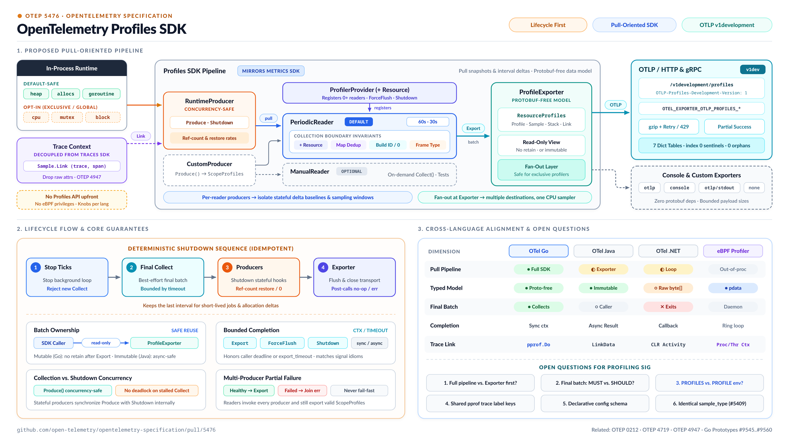
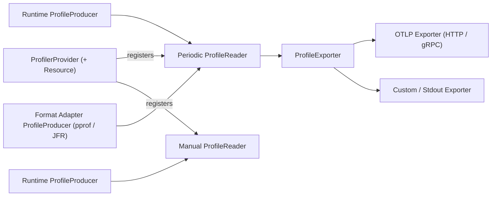

# Profiles SDK

Define an initial Alpha Profiles SDK specification covering lifecycle guarantees, pull-oriented collection components, boundary data invariants, and OTLP exporter configuration for in-process OpenTelemetry profiling SDKs.

## Motivation

Out-of-process profilers such as the [OpenTelemetry eBPF Profiler](https://github.com/open-telemetry/opentelemetry-ebpf-profiler) collect low-overhead CPU profiles across hosts without code changes, but cannot cheaply capture runtime-internal profiles such as live heap retention, allocation rates, goroutine stacks, lock contention, or managed runtime events, and cannot run in restricted environments without eBPF privileges.

The [OpenTelemetry Profiles specification](../../specification/profiles/README.md) currently defines the Alpha wire [data format](../../specification/profiles/data-format.md), [mapping attributes](../../specification/profiles/mappings.md), and [`pprof` compatibility](../../specification/profiles/pprof.md), with open pull requests for well-known `sample_type`/`period_type` values ([#5409](https://github.com/open-telemetry/opentelemetry-specification/pull/5409)) and Process Context Sharing ([#5370](https://github.com/open-telemetry/opentelemetry-specification/pull/5370)). However, there is no Profiles SDK specification yet.

As language SIGs start building experimental profiling SDKs and exporters in Go, Java, and .NET, core contracts are already diverging across three areas:

- Lifecycle guarantees, including whether shutdown collects a final batch, how exporters signal operation completion (synchronous context-bound calls, asynchronous result handles, or synchronous callbacks), and who owns batch memory during and after export.
- Pipeline architecture, specifically whether SDKs expose a pull-oriented `ProfilerProvider`/`ProfileReader`/`ProfileProducer`/`ProfileExporter` pipeline (mirroring the [Metrics SDK](../../specification/metrics/sdk.md)) or only an exporter interface and language-specific runtime hooks.
- Exporter and correlation contracts, including signal-specific OTLP configuration (`OTEL_EXPORTER_OTLP_PROFILES_*`, `/v1development/profiles`), exported attribute and mapping invariants, and how in-process SDKs and out-of-process eBPF readers align on populating `Sample.Link`.

Opening this OTEP alongside concrete Go prototypes gives the Profiling SIG and language SDK maintainers working code to evaluate while collection, lifecycle, and export contracts are still easy to change.

## Explanation

This proposal starts by comparing existing OpenTelemetry profiling implementations to establish shared lifecycle and data guarantees, then proposes a pull-oriented SDK component model and OTLP exporter configuration contract built on those guarantees.

### Cross-language comparison

Comparing the Go prototype design, Java's Alpha Profiles SDK, .NET Auto-Instrumentation's continuous profiler, and the eBPF profiler exposes concrete differences that an upstream Profiles SDK specification needs to address:

| Dimension | OTel Go `sdk/profile` prototype | OTel Java Alpha `sdk/profiles` | OTel .NET `ContinuousProfiler` | OTel eBPF Profiler | Candidate for upstream specification |
| :--- | :--- | :--- | :--- | :--- | :--- |
| Lifecycle guarantees | Synchronous `ctx`-bound calls; final collect-and-export on `Shutdown`; caller-owned `ResourceProfiles` not retained after `Export` | `ProfileExporter` (`export`, `flush`, `shutdown`) returning async `CompletableResultCode`; immutable `ProfileData` | `IContinuousProfilerExporter` export callbacks on raw `byte[]` buffers; `SampleExporter` loop exits on shutdown without collecting a final batch | Out-of-process eBPF ring buffer loop reporting via OTLP/gRPC | Yes: define batch ownership, operation completion, idempotent shutdown, and final-collection guarantees first |
| Component roles | `ProfilerProvider`, `Producer`, `Reader` (`PeriodicReader` and `ManualReader`), `Exporter` | `ProfileExporter` and `ProfilesDictionaryCompositor`; no `Provider`, `Reader`, or `Producer` yet | `ContinuousProfilerManager`, `SampleExporter`, `BufferProcessor`, `IContinuousProfilerExporter` | Reporter pipeline | Yes: standardize `ProfilerProvider`, `ProfileReader`, `ProfileProducer`, and `ProfileExporter` roles in Alpha, exposed through language-idiomatic APIs |
| Scheduling knobs | `interval` (`60s`), `timeout` (`30s`) | Exporter timeout; scheduling left to caller or shim | Per-sample-type `ExportInterval` and `ExportTimeout` | Collection interval | Yes: periodic export interval, export timeout, and exporter selection |
| Exporter input | Typed, protobuf-free `ResourceProfiles` | Typed, immutable `Collection<ProfileData>` | Raw native `byte[]` buffers | OTLP `Profiles` (`pdata`) | Yes: OTLP-aligned typed profile data model decoupled from wire protobuf types |
| Runtime profile knobs | `heap`, `allocs`, `goroutine`, opt-in `cpu`, delta flag (deferred: `mutex`, `block`) | JFR shim (`opentelemetry-jfr-profiles-shim`) | `ThreadSamplingInterval`, `MaxAllocationSamplesPerMinute`, `SelectedThreads` | Linux perf events | No: keep runtime profiler knobs language-specific; standardize `(sample_type, unit)` names via [#5409](https://github.com/open-telemetry/opentelemetry-specification/pull/5409) |
| Trace correlation | Trace/span `pprof` labels to `Sample.Link` | `LinkData` on `SampleData` | CLR thread-local active `Activity` and `SelectiveSampling` | `ProcessContext` + `ThreadContext` (`go_pprof_labels_v1` Go `pprof` labels read as sample attributes; `Sample.Link` from separate trace/span fields) | Yes: populate `Sample.Link` without duplicating raw trace/span IDs in sample attributes; align Go `pprof` label keys across in-process and eBPF readers |
| OTLP exporter config | `OTEL_EXPORTER_OTLP_PROFILES_*`, `/v1development/profiles`, `OTLP-Profiles-Development-Version: 1` | `OtlpGrpcProfileExporter` (OTLP/gRPC) | Plugin-provided exporter | OTLP/gRPC | Yes: formalize in `specification/protocol/exporter.md` |

### Core lifecycle and data guarantees

Regardless of language idioms, conforming Profiles SDKs would provide six behavioral guarantees:

1. **Batch ownership and non-retention.**
   - In languages with mutable SDK data types (such as Go's `*profiledata.ResourceProfiles`), `ProfileExporter.Export` MUST NOT retain references to the batch or its inner slices and structs after `Export` completes.
   - In languages with immutable SDK data types (such as Java's `ImmutableProfileData`), the SDK guarantees batches cannot be mutated while an asynchronous export is in flight.
   - In both models, the caller owns batch construction and the exporter receives only a read-only view for the duration of the export operation.
2. **Bounded operation completion.**
   - `Export`, `ForceFlush`, and `Shutdown` MUST report completion and failure within a caller-provided cancellation context, deadline, or configured export timeout.
   - Languages MAY expose completion synchronously (returning an error, as in Go) or asynchronously (returning a future or `CompletableResultCode`, as in Java), matching each language's existing Trace, Metric, and Log SDKs.
3. **Idempotent shutdown and teardown order.**
   - `Shutdown` MUST be idempotent. Subsequent calls to `Shutdown`, `Collect`, `ForceFlush`, or `Export` after shutdown MUST be rejected or treated as no-ops according to the language SDK's convention for other signals.
   - Periodic readers SHOULD follow a deterministic teardown order: stop periodic scheduling, perform one best-effort final collection and export bounded by the shutdown timeout or context, shut down attached stateful producers, and shut down the exporter.
   - Performing a final collection avoids losing the last interval in short-lived jobs and delta-based profiles (such as allocation deltas since the previous tick). Whether final collection is `MUST` or `SHOULD` is listed in [Open questions](#open-questions) given .NET's current immediate-exit behavior.
4. **Concurrency between collection and producer shutdown.**
   - `ProfileProducer.Produce` MUST be safe for concurrent invocation.
   - When `ProfileReader.Shutdown` runs, the reader MUST stop admitting new `Collect` calls immediately. A periodic reader stops its background loop and finishes its final collection before shutting down attached producers.
   - Readers are NOT required to block `Shutdown` waiting for arbitrary user-initiated concurrent `Collect` calls to finish before invoking producer `Shutdown`, because blocking could deadlock teardown when `Shutdown` is needed to close a resource that unblocks a stalled `Produce`.
   - Stateful producers that implement `Shutdown` MUST synchronize `Shutdown` with `Produce` and safely handle `Produce` calls that overlap with or arrive after shutdown.
5. **Default-safe runtime profiling.**
   - Built-in runtime profilers SHOULD default to profile kinds that do not mutate process-wide global sampling rates or exclusively claim single-owner runtime profilers (for example, Go permits only one active `runtime/pprof.StartCPUProfile` per process).
   - Exclusive or global-rate-mutating profilers SHOULD be opt-in and MUST release or restore runtime state on `Shutdown`, using reference counting when multiple instances can exist in one process.
6. **Collection-boundary data invariants.**
   - Consistent with [`map<string, AnyValue>`](../../specification/common/README.md#mapstring-anyvalue) in the Common specification, the SDK MUST by default enforce that exported map attributes (including maps nested inside arrays or other maps) contain only unique keys before `Collect` returns or a batch reaches any exporter. Implementations MAY enforce uniqueness at construction time (when the language's map type already forbids duplicate keys) or at the collection boundary (for example, by removing duplicates with last-value-wins semantics). Any duplicate removal performed by the SDK MUST preserve producer-owned input data without mutating it in place.
   - Converted runtime profiles MUST satisfy Alpha [Profiles Mappings Attributes](../../specification/profiles/mappings.md): every non-sentinel mapping MUST carry at least one of `process.executable.build_id.gnu`, `process.executable.build_id.go`, or `process.executable.build_id.htlhash`. Synthetic or unresolved runtime mappings with no filename or build ID MUST be left unset so OTLP encodes mapping index `0` while preserving stack and function data.
   - `profile.frame.type` MUST be classified per location rather than applied uniformly across a profile, because native and managed or runtime frames can appear in the same stack (for example, C frames inside a Go CPU profile). SDKs SHOULD emit the specific language value (such as `go`) for confirmed frames, `native` for confirmed native frames when no more precise value applies, and omit the attribute when the origin is unknown.

### Proposed pull-oriented SDK component model

Profiling data in language runtimes is predominantly sampled or captured as snapshots on a schedule and converted in batches rather than emitted event-by-event on request hot paths. As its preferred initial Alpha architecture, this OTEP models the Profiles SDK after the pull-oriented [Metrics SDK](../../specification/metrics/sdk.md) with four roles (`ProfilerProvider`, `ProfileProducer`, `ProfileReader`, and `ProfileExporter`), without requiring a separate `Profiles API` module upfront. SDKs MAY expose these roles through language-idiomatic APIs (such as interfaces, abstract classes, builders, or callbacks) rather than identical class hierarchies.

- **`ProfilerProvider`** owns SDK-level lifecycle and shared `Resource` configuration across zero or more registered `ProfileReader` instances. It exposes `ForceFlush` (delegating to readers that support flushing) and idempotent `Shutdown` (shutting down all registered readers).
- **`ProfileProducer`** owns profile acquisition and conversion into typed `ScopeProfiles`. It is the single-method extension point (`Produce`), plus an optional `Shutdown` hook for stateful sources such as built-in runtime profilers. Both built-in runtime profilers and format adapters implement `ProfileProducer` and attach per `ProfileReader` rather than on `ProfilerProvider`. Reader-scoped attachment prevents stateful delta baselines or continuous sampling windows from being corrupted when two readers collect on different intervals (for example, a 60s periodic OTLP reader alongside an on-demand diagnostic reader). When multiple destinations need the same collected batch, including single-owner profilers like Go CPU profiling, applications attach one producer to one reader and fan out at the `ProfileExporter` layer.
- **`ProfileReader`** owns collection scheduling, pulling `ScopeProfiles` from its attached producers, attaching the `ProfilerProvider`'s `Resource`, enforcing collection-boundary data invariants (where not already guaranteed at construction), and returning or passing the resulting `ResourceProfiles` batch to an exporter.
  - A periodic exporting `ProfileReader` runs a background schedule with configurable `export_interval` (default `60000` milliseconds) and `export_timeout` (default `30000` milliseconds). Its `ForceFlush` triggers an immediate collect-and-export cycle, resets the periodic timer, and flushes the exporter, while `Shutdown` runs the teardown sequence defined above.
  - A manual `ProfileReader` (optional, recommended for testing and custom pull pipelines) collects on demand when `Collect` is called and shuts down attached producers on `Shutdown`. Pull readers that hold no buffered export state MAY omit `ForceFlush` (matching Go's `sdk/metric.Reader`).
- **`ProfileExporter`** owns serialization and delivery of typed, protobuf-free profile data mirroring OTLP `v1development` (`ResourceProfiles`, `ScopeProfiles`, `Profile`, `Sample`, `Location`, `Mapping`, `Line`, `Function`, `ValueType`, `Link`, and `Attribute` with optional UCUM `Unit`). It exposes `Export`, `ForceFlush`, and `Shutdown`. Keeping the SDK data model independent of generated OTLP protobuf types avoids coupling the SDK API to Alpha protobuf schemas and keeps non-OTLP readers and HTTP-only exporters free of unnecessary transport dependencies.

Because format adapters implement the same `ProfileProducer` role as built-in runtime profilers, an application can attach a `pprof` converter or a JFR adapter (such as Java's `opentelemetry-jfr-profiles-shim`) to the same periodic `ProfileReader` and OTLP `ProfileExporter` used by a runtime producer. Inside `Produce`, a JFR adapter converts completed recording chunks into typed `ScopeProfiles`, and a `pprof` adapter decodes runtime or external `pprof` payloads into `ScopeProfiles`. The shared `ProfileReader` then attaches the `ProfilerProvider`'s `Resource`, drives periodic collection, and forwards the resulting `ResourceProfiles` batch through the shared `ProfileExporter`'s `Export`, `ForceFlush`, and `Shutdown` lifecycle so each adapter does not reimplement scheduling, resource attribution, or teardown.

### OTLP exporter and configuration contract

To make experimental Profiles SDKs interoperable with the OpenTelemetry Collector and backends, this OTEP proposes extending [OTLP Exporter Configuration](../../specification/protocol/exporter.md) and [SDK Environment Variables](../../specification/configuration/sdk-environment-variables.md) for the `profiles` signal at `Development` status:

- Support `OTEL_EXPORTER_OTLP_PROFILES_*` (`ENDPOINT`, `CERTIFICATE`, `CLIENT_KEY`, `CLIENT_CERTIFICATE`, `HEADERS`, `COMPRESSION`, `TIMEOUT`, `PROTOCOL`, and `INSECURE` where applicable) overriding `OTEL_EXPORTER_OTLP_*`, matching traces, metrics, and logs.
- Append `v1development/profiles` to `OTEL_EXPORTER_OTLP_ENDPOINT` for OTLP/HTTP when `OTEL_EXPORTER_OTLP_PROFILES_ENDPOINT` is not set, matching the [OTLP specification](https://github.com/open-telemetry/opentelemetry-proto/blob/main/docs/specification.md).
- Send `OTLP-Profiles-Development-Version: 1` on OTLP/HTTP requests and `otlp-profiles-development-version: 1` metadata on OTLP/gRPC requests while profiles remain in `v1development`.
- Follow standard OTLP compression (`gzip`), retry and throttling (`Retry-After` and `RetryInfo`), and partial-success (`ExportProfilesPartialSuccess.rejected_profiles`) handling, plus dictionary encoding invariants (index `0` sentinels across all seven `ProfilesDictionary` tables, canonical deduplication, and zero orphaned table entries).
- Define SDK exporter selection and scheduling environment variables as candidates once naming settles: `OTEL_PROFILES_EXPORTER` (`otlp`, `console`, `otlp/stdout`, `none`) and periodic export interval and timeout variables (see [Open questions](#open-questions) on singular vs. plural naming).

Runtime-specific profiler knobs (such as Go's `heap`, `allocs`, `goroutine`, and `cpu` toggles, Java's JFR event configuration, or .NET's sampling intervals) remain language-specific rather than standardized in this OTEP, while well-known `(sample_type, unit)` pairs are standardized separately in [#5409](https://github.com/open-telemetry/opentelemetry-specification/pull/5409).

### Trace context correlation boundary

Profiles SDKs SHOULD remain decoupled from the Traces SDK and from out-of-process context publication ([OTEP 4719: Process Context](4719-process-ctx.md) and [OTEP 4947: Thread Context](4947-thread-ctx.md)) so each can evolve independently without circular module dependencies.

At the specification level, this OTEP proposes standardizing only the correlation output contract:

- When a profile sample is correlated with an active span context, SDKs and readers MUST populate `Sample.Link` (`trace_id`, `span_id`) and SHOULD drop those raw trace and span ID labels from sample attributes to avoid duplicate representation.
- The in-process hook mechanism remains language-specific. For example, .NET reads CLR thread-local active `Activity` state, whereas Go cannot propagate `runtime/pprof` label contexts through `SpanProcessor` (because `OnStart` does not return a `context.Context` and `OnEnd` accepts no `context.Context`). Go also avoids API-layer `TracerProvider` wrappers, which break `defer span.End()` panic recording by inserting an extra call frame before `recover()` and carry the API-wrapping drawbacks discussed in [specification issue #4429](https://github.com/open-telemetry/opentelemetry-specification/issues/4429#issuecomment-2678489490). Instead, Go plans an experimental `sdk/trace` provider option paired with a scoped `pprof.Do` helper that preserves `Span.End` behavior without preloading span labels into `ctx` (which `pprof.Do` would otherwise restore after the callback returns).
- Out-of-process Go readers follow [OTEP 4947](4947-thread-ctx.md), where Go SDKs publish `threadlocal.schema_version = "go_pprof_labels_v1"` in `ProcessContext` so external readers inspect [Go `pprof` labels](https://github.com/open-telemetry/opentelemetry-ebpf-profiler/blob/main/design-docs/00002-custom-labels/README.md) directly. Because `opentelemetry-ebpf-profiler` currently reads Go `pprof` labels as sample attributes while filling `Sample.Link` from separate trace and span ID fields, agreement on `pprof` label keys and how they become `Sample.Link` needs to include both in-process Go SDKs and `opentelemetry-ebpf-profiler`.

## Internal details

### Specification documents impacted on integration

If this OTEP is approved, specification integration would update four areas, all starting at `Development` / `Alpha` status:

1. `specification/profiles/sdk.md` (new): lifecycle guarantees, data ownership, `ProfilerProvider`, `ProfileReader`, `ProfileProducer`, `ProfileExporter`, and collection-boundary invariants.
2. `specification/profiles/README.md`: link to `sdk.md`.
3. `specification/protocol/exporter.md`: add `profiles` to `OTEL_EXPORTER_OTLP_*` overrides, default HTTP path `v1development/profiles`, and development version header and metadata.
4. `specification/configuration/sdk-environment-variables.md` and [opentelemetry-configuration](https://github.com/open-telemetry/opentelemetry-configuration): add `OTEL_PROFILES_EXPORTER`, periodic scheduling variables, and corresponding declarative configuration schema entries once naming settles.

### Error modes and partial failures

- A `ProfileReader` collecting from multiple producers SHOULD invoke all registered producers and aggregate errors rather than failing fast on the first producer error, while still exporting valid `ScopeProfiles` produced by healthy producers.
- Periodic collection and export MUST enforce `export_timeout` (or a caller's tighter deadline on `ForceFlush` and `Shutdown`). OTLP exporters follow existing retryable status handling (`429`, `502`, `503`, `504` over HTTP; retryable gRPC codes and `RetryInfo` throttling) bounded by the export timeout.
- When an OTLP receiver returns `ExportProfilesPartialSuccess` with `rejected_profiles > 0`, the exporter MUST surface or log the rejection according to the OTLP partial-success specification rather than silently treating it as full success.
- Exporters SHOULD support bounded request sizes (and bounded decompressed response sizes) so malformed or unexpectedly large profiles cannot exhaust application memory.

### Corner cases

- Some runtimes restrict a profiler to one active session per process (such as Go's CPU profiler) or expose global rate setters without a getter (such as Go's `runtime.SetBlockProfileRate`, unlike `runtime.SetMutexProfileFraction` which returns the previous rate). Runtime producers MUST document ownership semantics explicitly: reference-count shared state across instances where possible, restore saved rates on the last `Shutdown` when the runtime exposes the previous rate, and reset owned rates to disabled (`0`) on the last `Shutdown` when no getter exists.
- When a runtime profiler cannot resolve executable mappings (for example, Go `pprof` when `/proc/self/maps` is unavailable or returns no mappings), it may emit a synthetic mapping lacking a filename and build ID. Converters MUST leave that mapping unset (`mapping_index = 0`) instead of emitting a non-sentinel `Mapping` without a build ID, while keeping the stack frames and function metadata intact.
- Stack samples from runtimes that support FFI or `cgo` can contain both language frames and C or native frames in one stack. Setting `profile.frame.type` per location prevents mislabeling native frames.
- In languages whose `map<string, AnyValue>` representation allows duplicate keys at construction time (including inside nested maps or arrays of maps), producers or custom instrumentation can pass duplicate keys to the SDK. Removing duplicates once at the collection boundary with copy-on-change updates satisfies the Common specification's unique-key guarantee without mutating producer-owned inputs or allocating on scalar attributes.
- Within a collected batch, sharing `Location` and `Mapping` references lets OTLP encoders cache dictionary indexes by object identity before falling back to canonical content deduplication, reducing encoding allocations while keeping `ProfilesDictionary` orphan-free.

## Trade-offs and mitigations

- Standardizing `ProfilerProvider`, `ProfileReader`, and `ProfileProducer` alongside `ProfileExporter` adds more concepts than Java's current exporter-only Alpha API. Exposing each role through language-idiomatic APIs and keeping `ManualReader` optional lets language SIGs adopt the shared lifecycle and format-adapter pipeline without forcing identical class hierarchies across languages.
- Running a final collect-and-export on `Shutdown` can delay process termination if the exporter is slow or unreachable. Bounding final collection and export with the caller's shutdown context, deadline, or `export_timeout` keeps teardown predictable and best-effort.
- Keeping SDK profile types decoupled from generated OTLP protobuf structs introduces a translation step in OTLP exporters. Sharing `Location` and `Mapping` object references within a batch enables pointer-identity dictionary index caching, and encoding overhead can be verified with benchmarks (as tracked in the Go prototypes).
- Making CPU, mutex, and block profiling opt-in means a zero-option runtime profiler will not emit CPU profiles by default in runtimes where CPU profiling is exclusive. This prevents conflicts with existing `net/http/pprof` handlers or out-of-process eBPF CPU profilers while leaving opt-in CPU profiling one option away.
- Deferring a `Profiles API` prevents libraries from emitting user-triggered profiles through a global API today. Continuous profiling has no established manual-instrumentation API callers yet, and `ProfilerProvider` can implement a future API cleanly without breaking existing SDK wiring.

## Prior art and alternatives

- **Push-based `Processor` model (Logs and Traces SDK).** Traces and logs emit discrete events on request paths and batch them through `SpanProcessor` and `LogRecordProcessor`. Runtime profiles are collected as periodic snapshots or interval deltas and converted in batches, which maps directly to the [Metrics SDK](../../specification/metrics/sdk.md) pull model (`Provider`, `Reader`, `Producer`, `Exporter`).
- **Exporter-only specification (Java Alpha `sdk/profiles`).** Standardizing only `ProfileExporter` and `ProfileData` is simpler initially, but leaves lifecycle ownership, periodic scheduling, resource attachment, format-adapter integration, and runtime-source teardown unspecified across languages. This OTEP incorporates Java's typed `ProfileData` and asynchronous completion model, while preferring all four pipeline roles in the initial Alpha specification so format adapters and runtime profilers share one collection and export lifecycle.
- **Callback-based raw-buffer export (.NET `ContinuousProfiler`).** Passing raw native `byte[]` buffers to plugin callbacks minimizes managed allocations for CLR native samplers, but couples exporters to runtime-specific binary formats and currently lacks exporter `Flush` and `Shutdown` hooks as well as final batch collection on shutdown.
- **Attaching `ProfileProducer` to `ProfilerProvider` instead of `ProfileReader`.** Registering a stateful producer once on `ProfilerProvider` allows multiple readers to pull from the same producer, silently corrupting delta baselines and CPU sampling windows when an on-demand diagnostic read runs between periodic exports. Reader-scoped attachment prevents this by construction.
- **Exposing OTLP protobuf types directly in the SDK API.** This avoids a translation layer, but leaks Alpha `v1development` wire schema changes into user code and pulls heavy protobuf and gRPC dependencies into non-OTLP readers and HTTP-only exporters.
- **API-layer `TracerProvider` wrapper for trace-to-profile correlation.** Wrapping `Tracer.Start` and `Span.End` at the API layer works without modifying the Traces SDK, but in Go breaks `sdk/trace`'s `defer span.End()` panic recording (due to `recover()` call-frame depth) and carries the API-wrapping drawbacks documented in [specification issue #4429](https://github.com/open-telemetry/opentelemetry-specification/issues/4429#issuecomment-2678489490).

## Open questions

1. This OTEP prefers specifying `ProfilerProvider`, `ProfileReader`, `ProfileProducer`, and `ProfileExporter` together in the initial Alpha `specification/profiles/sdk.md`, exposed through language-idiomatic APIs. Are there language-specific constraints in Java, .NET, Python, or Rust that would block adopting all four roles in Alpha?
2. Should periodic readers be required (`MUST`) or recommended (`SHOULD`) to collect and export a final batch on `Shutdown`, given that Go's prototype flushes a final batch (matching Metrics SDK) while .NET's `SampleExporter` currently exits its loop without one?
3. Should periodic scheduling environment variables use plural `OTEL_PROFILES_EXPORT_INTERVAL` and `OTEL_PROFILES_EXPORT_TIMEOUT` (matching `OTEL_PROFILES_EXPORTER` and `OTEL_EXPORTER_OTLP_PROFILES_*`) or singular `OTEL_PROFILE_EXPORT_INTERVAL` and `OTEL_PROFILE_EXPORT_TIMEOUT` (matching `OTEL_METRIC_EXPORT_INTERVAL` and `OTEL_METRIC_EXPORT_TIMEOUT`)?
4. Which `pprof` label keys should represent trace and span IDs (`otel.trace_id`/`otel.span_id` vs. `trace_id`/`span_id`), and how should both in-process Go SDKs and out-of-process `opentelemetry-ebpf-profiler` convert those labels into `Sample.Link`?
5. What schema shape should [opentelemetry-configuration](https://github.com/open-telemetry/opentelemetry-configuration) adopt for profile providers, readers, runtime producers, and exporters?
6. How should profiles that emit identical `sample_type` values (such as Go `mutex` and `block` profiles) be distinguished on the wire (under discussion in [#5409](https://github.com/open-telemetry/opentelemetry-specification/pull/5409#discussion_r4534499496))?

## Prototypes

Concrete design documents and implementations backing this proposal:

- OpenTelemetry Go design document: [opentelemetry-go#9560](https://github.com/open-telemetry/opentelemetry-go/pull/9560) (tracking issue [opentelemetry-go#8449](https://github.com/open-telemetry/opentelemetry-go/issues/8449))
- OpenTelemetry Go implementation stack:
  - [opentelemetry-go#9545](https://github.com/open-telemetry/opentelemetry-go/pull/9545): core `sdk/profile` (`ProfilerProvider`, `Producer`, `Reader`, `ManualReader`, `PeriodicReader`, `Exporter`) and protobuf-free `sdk/profile/profiledata`
  - [opentelemetry-go#9558](https://github.com/open-telemetry/opentelemetry-go/pull/9558): `sdk/profile/internal/pprof` decoder, delta subtraction, build ID cache, and converter
  - [opentelemetry-go#9559](https://github.com/open-telemetry/opentelemetry-go/pull/9559): `RuntimeProducer` for Go runtime profiles
  - [opentelemetry-go#9546](https://github.com/open-telemetry/opentelemetry-go/pull/9546): `otlpprofilehttp` exporter (using slim protobuf and shared `gotmpl` transform)
  - [opentelemetry-go#9547](https://github.com/open-telemetry/opentelemetry-go/pull/9547): `otlpprofilegrpc` exporter
- OpenTelemetry Java Alpha Profiles SDK: [`sdk/profiles`](https://github.com/open-telemetry/opentelemetry-java/tree/main/sdk/profiles) and [`exporters/otlp/profiles`](https://github.com/open-telemetry/opentelemetry-java/tree/main/exporters/otlp/profiles)
- OpenTelemetry .NET Auto-Instrumentation: [`ContinuousProfiler`](https://github.com/open-telemetry/opentelemetry-dotnet-instrumentation/tree/main/src/OpenTelemetry.AutoInstrumentation/ContinuousProfiler) and [`PluginApi/ContinuousProfiling`](https://github.com/open-telemetry/opentelemetry-dotnet-instrumentation/tree/main/src/OpenTelemetry.AutoInstrumentation.PluginApi/ContinuousProfiling)
- OpenTelemetry eBPF Profiler: [OpenTelemetry eBPF Profiler](https://github.com/open-telemetry/opentelemetry-ebpf-profiler) (including [Go custom labels design](https://github.com/open-telemetry/opentelemetry-ebpf-profiler/blob/main/design-docs/00002-custom-labels/README.md))

## Future possibilities

- Integrate `specification/profiles/sdk.md`, `specification/protocol/exporter.md` profiles updates, and `specification/configuration/sdk-environment-variables.md` additions once this OTEP is approved.
- Add declarative configuration support for profiles pipelines in [opentelemetry-configuration](https://github.com/open-telemetry/opentelemetry-configuration).
- Specify console (`stdout`) and OTLP file (`otlp/stdout`) profile exporters for local development and debugging.
- Add optional `ProfileFilter`, attribute limits, or symbol and frame redaction hooks at the `ProfileReader` boundary if cross-language use cases emerge.
- Introduce a `Profiles API` if future use cases require library-level manual profiling hooks beyond SDK-driven runtime collection and trace correlation.
